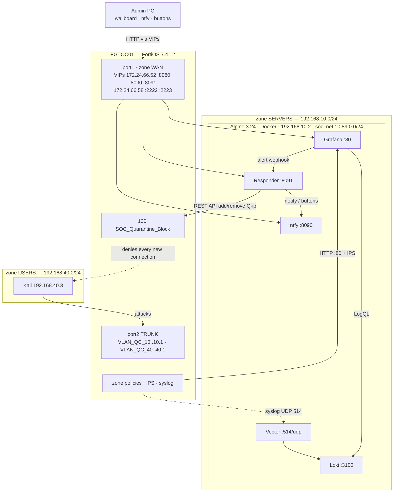

<!-- filepath: https://github.com/rabakuku/Youtube/blob/main/Video-3-Visual-SOC-Analytics-Traffic-Dashboard/README.md -->
# 🛡️ I Attacked My Own SOC — and Quarantined Myself with One Click

**Kali attacks, the FortiGate blocks, a free Grafana SOC detects it, and an alert on your PC asks "Quarantine 192.168.40.3 for 15 minutes?" — one click and the attacker is cut off. Vector + Loki + Grafana + ntfy on Alpine, zero license cost.**


> 🎬 **Watch the build:** _video link coming soon_ · 📺 Channel: **Deploy & Defend**

---

## Contents

1. [What you will build](#1-what-you-will-build)
2. [Topology](#2-topology)
3. [Prerequisites](#3-prerequisites)
4. [Deploy the SOC on Alpine](#4-deploy-the-soc-on-alpine)
5. [Configure & verify the FortiGate](#5-configure--verify-the-fortigate)
6. [Run the demo: detect → approve → quarantine](#6-run-the-demo-detect--approve--quarantine)
7. [The responder](#7-the-responder)
8. [Rollback](#8-rollback)
9. [Upgrading an existing install](#9-upgrading-an-existing-install)
10. [Repository structure](#10-repository-structure)
11. [Troubleshooting quick links](#11-troubleshooting-quick-links)
12. [Credits & license](#12-credits--license)

---

## 1. What you will build

| Kali does | FortiGate (FGTQC01) does | Your PC shows |
|---|---|---|
| `nmap` sweep + 1,000-port scan | Logged **deny** on everything except HTTP to the dashboard | THREAT LEVEL **UNDER ATTACK**, scanned ports ranked live |
| — | Grafana rule *Port scan detected* fires (MITRE T1046) | ntfy alert: **[Quarantine 15 minutes] [Ignore] [Wallboard]** |
| — | You click **Quarantine** → REST API adds `Q-192.168.40.3` to `SOC-Quarantine` | "192.168.40.3 **quarantined for 15 minutes**" + **[Release now]** |
| SQLi, traversal, Log4Shell, Nikto on port 80 | Top policy **SOC_Quarantine_Block** drops every new connection | Every request times out; wallboard **QUARANTINED 1**, purple markers |
| — | Timer ends (or Release now) → member removed | "192.168.40.3 **released**" |

**Highlights**

- Auto-provisioned **Live Wallboard** and **Detections & Response** dashboard — threat level, timeline, top attackers/ports/IPS signatures, kill chain, quarantine status and a responder audit trail.
- Vector tags every FortiOS log **blocked / detected / allowed**; three Grafana rules (port scan, IPS web attack, silent log feed).
- A ~550-line Python **responder** (standard library only): approval buttons or automatic mode, signed one-time links, allowlist, timers, restart-safe, least-privilege FortiGate API token.
- **Kali never reaches WAN** (work-lab rule): an explicit logged deny, and scripts arrive by `scp` through an SSH VIP.

---

## 2. Topology



| Node | IP | Zone / Interface | Role |
|---|---|---|---|
| FGTQC01 | 192.168.10.1 · 192.168.40.1 · 172.24.66.52 (+ .58) | SERVERS VLAN_QC_10 · USERS VLAN_QC_40 · WAN port1 | Gateway, IPS, syslog, VIPs, REST API, quarantine |
| soc-alpine | 192.168.10.2 | SERVERS | Docker: Vector, Loki, Grafana, ntfy, responder |
| kali | 192.168.40.3 | USERS | Attacker — no WAN access |
| admin PC | home LAN | outside the lab | Wallboard, ntfy, Approve/Release |

| Admin PC URL | VIP → inside |
|---|---|
| `http://172.24.66.52:8080` — Grafana | HTTP-TO-Grafana → 192.168.10.2:80 |
| `http://172.24.66.52:8090/<NTFY_TOPIC>` — ntfy | NTFY-TO-SOC → 192.168.10.2:8090 |
| `http://172.24.66.52:8091` — responder buttons | RESPONDER-TO-SOC → 192.168.10.2:8091 |
| `ssh -p 2223 <user>@172.24.66.58` — Kali | SSH-TO-KALI → 192.168.40.3:22 |

| Order | Policy | From → To | Action |
|---|---|---|---|
| 1 | **100 SOC_Quarantine_Block** | any → any, source `SOC-Quarantine` | deny + log |
| 2 | 2 SERVERS TO WAN | SERVERS → WAN | accept + NAT (Alpine updates) |
| 3 | 3 **Kali_To_SOC_Web** | USERS → SERVERS, HTTP to SOC-Host | accept + **IPS** |
| 4 | **101 Kali_To_Servers_Deny** | USERS → SERVERS | deny + log |
| 5 | 4 VIP TO INTERNAL | WAN → SERVERS/USERS (VIPs) | accept |
| 6 | **102 Kali_To_WAN_Deny** | USERS → WAN | deny + log |

Full design, flows, event sequence and trust boundaries: **[docs/Lab-Matrix.md](docs/Lab-Matrix.md)**

---

## 3. Prerequisites

| Item | Requirement |
|---|---|
| FortiGate | FortiOS **7.4.x** (tested target 7.4.12), zone-based policies, VDOMs disabled. IPS signatures for the web-attack part (bundled firmware signatures usually suffice) |
| SOC host | **Alpine Linux 3.24**, 2 vCPU, 2 GB RAM, 10 GB disk, root, **192.168.10.2** (DHCP reservation), outbound HTTPS/DNS via `SERVERS TO WAN` |
| Attacker | **Kali Linux 192.168.40.3** (DHCP reservation), standard image (`nmap`, `curl`, `nikto`) — **no internet** |
| Admin PC | Reaches 172.24.66.52/.58 (FortiGate port1); modern browser for Grafana and the ntfy web app |
| Upstream | 172.24.66.52 reserved for the FortiGate port1 MAC (port1 is DHCP and carries the VIPs) |

> ⚠️ **Lab use only.** Attack only systems you own or are authorised to test. The campaign script refuses targets outside 192.168.10.0/24.

---

## 4. Deploy the SOC on Alpine

Run as **root** on **192.168.10.2**:

```sh
mkdir -p /opt/visual-soc-analytics-traffic-dashboard && cd /opt/visual-soc-analytics-traffic-dashboard
curl -fsSLO https://raw.githubusercontent.com/rabakuku/Youtube/main/Video-3-Visual-SOC-Analytics-Traffic-Dashboard/scripts/setup.sh
chmod +x setup.sh
./setup.sh
```

**What `setup.sh` does:** checks Alpine + root → installs only missing tools (`curl`, `docker`, `docker-cli-compose`) → downloads the stack, dashboards, alert rules, contact point and responder → creates or upgrades `compose/.env` and **generates** the Grafana password, ntfy topic and button-signing secret → asks once for the **FortiGate API token** (Enter = dry-run) and tests it → checks ports 80, 514, 8090, 8091 → raises the UDP buffer for syslog bursts → pulls pinned images → waits for 5 healthy containers → self-tests syslog → Loki, the responder and ntfy → prints the URLs, the ntfy subscribe link and the login.

| Option | Use |
|---|---|
| `--fgt-token KEY` | Store the FortiGate API key from [Fortinet-cli.md step 8](docs/Fortinet-cli.md#8-rest-api-admin-for-the-responder) |
| `--dry-run` | Remove the token: notifications, buttons and timers work, the FortiGate is never changed |
| `--no-prompt` | Never ask (automatic under `curl \| sh`) |

**`compose/.env`** (mode 600, never committed) — edit, then re-run `./setup.sh`:

| Variable | Default | Purpose |
|---|---|---|
| `PUBLIC_GRAFANA_URL` · `PUBLIC_NTFY_URL` · `PUBLIC_RESPONDER_URL` | `http://172.24.66.52:8080/8090/8091` | How the admin PC reaches the lab (used in alert links and buttons) |
| `QUARANTINE_MODE` | `approve` | `approve` = buttons · `auto` = quarantine at once |
| `QUARANTINE_MINUTES` | `15` | Ban length |
| `QUARANTINE_ALLOWLIST` | `192.168.10.0/24,192.168.40.1/32,172.24.66.0/24` | Never quarantined |
| `FGT_API_TOKEN` | empty | Empty = dry-run |
| `NTFY_TOPIC` · `RESPONDER_SECRET` · `GRAFANA_ADMIN_PASSWORD` | generated | Topic name, link signing, Grafana login |
| `LOKI_RETENTION_PERIOD` | `168h` | Log retention |

**Verify** (details: **[scripts/vt.md](scripts/vt.md)**):

```sh
cd /opt/visual-soc-analytics-traffic-dashboard/compose
docker compose ps                                                     # 5 containers (healthy)
netstat -tulpn | grep -E ':(80|514|3100|8090|8091)\b'                 # 3100 on 127.0.0.1 only; no 8092
curl -s http://127.0.0.1:8091/health                                  # "ok": true, "dry_run": false after Stage 4
docker network inspect soc_net --format '{{range .IPAM.Config}}{{.Subnet}}{{end}}'   # 10.89.0.0/24
```

---

## 5. Configure & verify the FortiGate

Paste **[docs/Fortinet-cli.md](docs/Fortinet-cli.md)** in order (GUI version: **[docs/Fortinet-gui.md](docs/Fortinet-gui.md)**). Existing policies 2–4 are kept; new ones use IDs 100–102:

0. **Back up**, check VDOM mode, IPS package and `firewall-session-dirty check-all`
1. **DHCP reservations** for 192.168.10.2 and 192.168.40.3
2. **Admin access:** VLAN_QC_10 `ping https ssh`, VLAN_QC_40 `ping` only
3. **Objects:** `SOC-Host`, `Kali-Attacker`, group `SOC-Quarantine` (member `none`)
4. **IPS sensor** `SOC-Demo-IPS`
5. **VIPs** `NTFY-TO-SOC` :8090 and `RESPONDER-TO-SOC` :8091, appended to `VIP TO INTERNAL` (optional: source locked to `ADMIN-PC`)
6. **Policies:** policy 3 narrowed to HTTP → `Kali_To_SOC_Web`; new **100** quarantine (moved to top), **101** USERS→SERVERS deny, **102** USERS→WAN deny
7. **Syslog** to 192.168.10.2 UDP 514
8. **REST API admin** `soc-responder` (profile: firewall address read-write only, trusthost 192.168.10.2) → `./setup.sh --fgt-token <KEY>`
9. **Scripts onto Kali** via `scp -P 2223`
10. **Smoke test** `diagnose log test`

**Key checks** (full guide with expected output: **[docs/vt.md](docs/vt.md)**):

```text
show firewall policy | grep -E "^    edit|set name"     # 100, 2, 3, 101, 4, 102
show firewall addrgrp SOC-Quarantine                    # member "none"
get log syslogd setting                                 # server 192.168.10.2 port 514
diagnose debug flow filter saddr 192.168.40.3           # + trace start / debug enable
                                                        # → policy 101 (scan), 102 (WAN), 100 (quarantined)
```

From Kali: `curl -sI http://192.168.10.2` → `302`; `nmap -Pn -p 22,443,3100 192.168.10.2` → filtered; `curl -m 5 http://1.1.1.1` → timeout (policy 102).

---

## 6. Run the demo: detect → approve → quarantine

Full walkthrough, dashboard guide and common mistakes: **[docs/config.md](docs/config.md)**

1. On the PC open the wallboard (`:8080`) and ntfy (`:8090/<NTFY_TOPIC>` → **Subscribe**, allow notifications).
2. Copy the campaign to Kali: `scp -P 2223 Video-3-Visual-SOC-Analytics-Traffic-Dashboard/scripts/kali-attack-campaign.sh <user>@172.24.66.58:~/`
3. On Kali: `sudo ./kali-attack-campaign.sh` — phase 1 recon, phase 2 port scan.
4. Within ~60 s: ntfy **Port scan detected: 192.168.40.3** → click **Quarantine 15 minutes**.
5. Phase 3 web attacks all time out; wallboard **QUARANTINED 1**, `policy=100 (SOC_Quarantine_Block)` in the stream, **Response Actions** shows the decision.
6. **Release now** (or wait) → ntfy **released**; investigate in **Visual SOC · Detections & Response** (kill chain, attacker profile, conversations).

| Rule | Fires when | MITRE |
|---|---|---|
| Port scan detected | > 20 distinct denied ports from one source in 60 s | T1046 |
| Web attack blocked by IPS | any IPS signature match | T1190 |
| FortiGate log feed silent | no logs for 5 minutes | — |

**Verify:** during the quarantine `show firewall addrgrp SOC-Quarantine` lists `Q-192.168.40.3`; after release it is back to `"none"` and Kali's `curl -sI http://192.168.10.2` returns `302` again.

---

## 7. The responder

`app/responder/responder.py` — Python standard library only, mounted into `python:3.12.7-alpine3.20`.

| Port | Reachable from | Endpoints |
|---|---|---|
| 8092 | **only inside soc_net** (not published) | `POST /grafana` (Grafana webhook) · `POST /release-all` · `GET /health` |
| 8091 | VIP 172.24.66.52:8091 | `GET\|POST /a/<signed-token>` (buttons) · `GET /health` |

**Safety rails:** allowlist (SOC VLAN, USERS gateway, admin side) · one active ban per IP and no duplicate approvals · HMAC-signed links that expire (30 min) and work once · GET only shows a confirm page, the action needs POST · automatic expiry + **Release now** · state persisted, orphaned `Q-*` objects adopted and released after restarts · "Quarantine FAILED" alert instead of fake success · every action audited to Loki (`{source="responder"}`) · **dry-run** without a token · FortiGate token only in the responder container, profile limited to address objects (`403` on policies).

Test without attacking anything (on Alpine):

```sh
docker exec soc-responder wget -q -O- --header 'Content-Type: application/json' --post-data \
 '{"alerts":[{"status":"firing","labels":{"alertname":"Port scan detected","srcip":"192.168.40.3","severity":"high"},"annotations":{"description":"Manual test alert"}}]}' \
 http://127.0.0.1:8092/grafana
```

---

## 8. Rollback

**Alpine** — `setup.sh` places `rollback.sh` in `/opt/visual-soc-analytics-traffic-dashboard/`. It **releases every active quarantine first**, so Kali is never left banned.

```sh
cd /opt/visual-soc-analytics-traffic-dashboard
./rollback.sh                    # interactive menu
./rollback.sh --containers       # stop/remove containers, keep data
./rollback.sh --all --yes        # everything, no prompts
```

| Option | Removes |
|---|---|
| `--containers` | 5 containers (logs, dashboards, state kept) |
| `--volumes` | Containers **and** volumes (all logs, Grafana data, ntfy cache, responder state) |
| `--images` | Vector, Loki, Grafana, ntfy and Python images |
| `--files` | `/opt/visual-soc-analytics-traffic-dashboard` (configs, `.env`) |
| `--tools` | Only what `setup.sh` installed (docker, compose plugin, curl, sysctl file) |
| `--all` · `--yes` · `--help` | Everything in safe order · no prompts · usage |

**FortiGate** — run Alpine's rollback first, then **[Fortinet-cli.md step 11](docs/Fortinet-cli.md#11-rollback--remove-everything-this-guide-added)**: deletes policies 100–102, restores policy 3 to `USERS TO SERVERS` accept-all, removes the two VIPs from policy 4, the API user, profile, group and objects.

---

## 9. Upgrading an existing install

Re-run the latest `setup.sh` — it keeps `compose/.env` (password, token, topic) and data volumes, merges new settings, recreates `soc_net` on 10.89.0.0/24 if an older version created it elsewhere, removes retired dashboards and restarts every service so new configs apply:

```sh
cd /opt/visual-soc-analytics-traffic-dashboard
curl -fsSLO https://raw.githubusercontent.com/rabakuku/Youtube/main/Video-3-Visual-SOC-Analytics-Traffic-Dashboard/scripts/setup.sh
./setup.sh
```

---

## 10. Repository structure

```text
Video-3-Visual-SOC-Analytics-Traffic-Dashboard/
├── README.md                       ← you are here
├── scripts/
│   ├── setup.sh                    one-command Alpine deploy / upgrade (+ self-tests)
│   ├── rollback.sh                 selectable teardown (releases quarantines first)
│   ├── vt.md                       Alpine/container verification & troubleshooting
│   └── kali-attack-campaign.sh     3-phase demo attack (runs on Kali, lab-guarded)
├── compose/
│   ├── docker-compose.yml          Vector · Loki · Grafana · ntfy · responder · soc_net 10.89.0.0/24
│   ├── .env.example                images, VIP URLs, quarantine settings, FortiGate API
│   ├── vector.yaml                 FortiOS key=value parser → blocked/detected/allowed
│   ├── local-config.yaml           Loki single-node, tuned against 429s, 7-day retention
│   ├── grafana-datasource.yaml     Loki datasource (uid loki-fortigate)
│   ├── grafana-dashboards.yaml     dashboard provider
│   ├── grafana-contact-points.yaml every alert → soc-responder (internal :8092)
│   └── soc-wallboard.json          Live Wallboard (home dashboard)
├── app/
│   ├── responder/responder.py      Grafana → ntfy buttons → FortiGate quarantine
│   ├── alert-rules.yaml            3 Grafana alert rules
│   └── app-advanced.json           Visual SOC · Detections & Response
├── docs/
│   ├── Lab-Matrix.md               design source of truth
│   ├── Fortinet-cli.md             FGTQC01 CLI in order (+ rollback)
│   ├── Fortinet-gui.md             same config as GUI click-paths
│   ├── vt.md                       FortiGate verification & troubleshooting
│   └── config.md                   wallboard, campaign, approval, investigation
├── presentation/                   slide deck + teleprompter (video)
└── marketing/                      YouTube description, tags, timestamps
```

---

## 11. Troubleshooting quick links

| Problem | Go to |
|---|---|
| Containers unhealthy, ports busy, image pulls fail | [scripts/vt.md → Troubleshooting](scripts/vt.md#9-troubleshooting) |
| No data on the wallboard | [scripts/vt.md → Is FortiGate data arriving?](scripts/vt.md#7-is-fortigate-data-arriving) |
| Responder in DRY-RUN, token rejected, buttons do nothing | [scripts/vt.md → Responder](scripts/vt.md#5-responder) · [docs/vt.md → Symptom → fix](docs/vt.md#7-symptom--fix) |
| Kali reaches something it should not | [docs/vt.md → What Kali can and cannot reach](docs/vt.md#2-kali-what-it-can-and-cannot-reach-run-on-kali) |
| Quarantine shown in ntfy but Kali still connects | [docs/vt.md → End-to-end quarantine test](docs/vt.md#5-end-to-end-quarantine-test) |
| No ntfy alert after the scan, alerts in *Error* | [docs/config.md → Common mistakes](docs/config.md#common-mistakes) |
| Forgot the Grafana password / ntfy topic | `grep -E 'GRAFANA_ADMIN_PASSWORD\|NTFY_TOPIC' /opt/visual-soc-analytics-traffic-dashboard/compose/.env` |

**Production notes:** UDP syslog is plaintext — use reliable/encrypted syslog or FortiAnalyzer in production; put Grafana, ntfy and the responder behind HTTPS and authentication; tune the IPS sensor instead of forcing every signature on; an address-group quarantine only covers traffic the FortiGate routes — same-VLAN isolation needs switch/NAC quarantine.

---

## 12. Credits & license

- Built for the **Deploy & Defend** YouTube channel — 🎬 _video link coming soon_
- Open-source stack: [Vector](https://vector.dev/docs/) · [Grafana Loki](https://grafana.com/docs/loki/latest/) · [Grafana](https://grafana.com/docs/grafana/latest/) · [ntfy](https://docs.ntfy.sh/) · [Alpine Linux](https://alpinelinux.org/) · [Docker](https://docs.docker.com/)
- Fortinet, FortiGate and FortiOS are trademarks of Fortinet, Inc. This is an independent community lab, not affiliated with or endorsed by Fortinet.
- License: _add a LICENSE file to this repository and reference it here._
