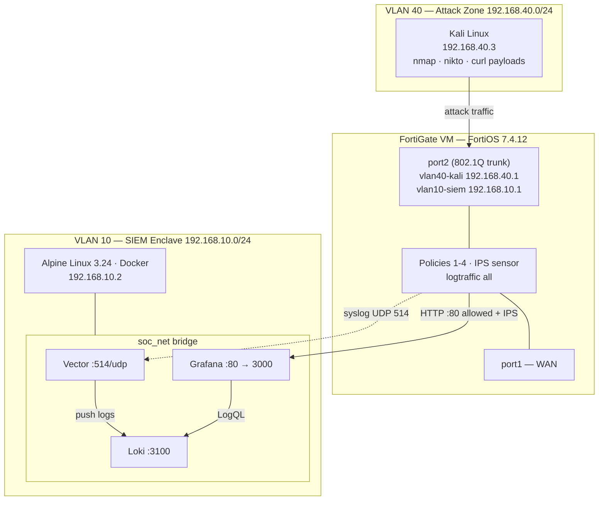

<!-- filepath: https://github.com/rabakuku/Youtube/blob/main/Video-3-Visual-SOC-Analytics-Traffic-Dashboard/README.md -->
# 🛡️ I Attacked My Own SOC — Zero-Cost FortiGate SIEM Wallboard

**Launch a real attack from Kali, watch the FortiGate block it, and see every blocked packet light up a live SOC wallboard seconds later — built from free tools: Vector, Loki and Grafana on Alpine Linux.**


> 🎬 **Watch the build:** _video link coming soon_ · 📺 Channel: **Deploy & Defend**

---

## Contents

1. [What you will build](#1-what-you-will-build)
2. [Topology](#2-topology)
3. [Prerequisites](#3-prerequisites)
4. [Deploy the SIEM on Alpine](#4-deploy-the-siem-on-alpine)
5. [Configure & verify the FortiGate](#5-configure--verify-the-fortigate)
6. [Dashboards, attack campaign & detections](#6-dashboards-attack-campaign--detections)
7. [Rollback](#7-rollback)
8. [Repository structure](#8-repository-structure)
9. [Troubleshooting quick links](#9-troubleshooting-quick-links)
10. [Credits & license](#10-credits--license)

---

## 1. What you will build

| You do this on Kali | The FortiGate does this | The wallboard shows this |
|---|---|---|
| `nmap` sweep + 1,000-port scan | Explicit **deny policy** blocks and logs every probe | THREAT LEVEL → **UNDER ATTACK**, scanned ports ranked live |
| SQLi, path traversal, Log4Shell, Shellshock, Nikto on port 80 | **IPS** inspects the only allowed port and drops the payloads | Named IPS signatures, red event stream, alert fires |
| Stop the attack | — | Back to **ALL CLEAR** about 60 s later |

Everything is free and open source on the SIEM side: **FortiGate syslog → Vector (parser) → Loki (log store) → Grafana (wallboard + alerts)**, deployed with one script.

**Highlights**

- Auto-provisioned **Live Wallboard** with a THREAT LEVEL tile, attack timeline, top attackers, top scanned ports, top IPS signatures and a color-coded event stream.
- Vector tags every FortiOS log as **blocked / detected / allowed**, so firewall denies and IPS drops are counted the same way.
- Three extra dashboards (Quickstart, Threat Hunting, Detections & Forensics) and **three alert rules** mapped to MITRE ATT&CK (T1046 port scan, T1190 web exploit, plus log-feed health).
- A scripted, lab-guarded **Kali attack campaign** made for live demos.

---

## 2. Topology



| Node | Hostname | IP / Mask | Gateway | VLAN | Role |
|---|---|---|---|---|---|
| 1a | FortiGate-VM | 192.168.10.1/24 | — | 10 (`vlan10-siem` on port2) | SIEM-side gateway, syslog source |
| 1b | FortiGate-VM | 192.168.40.1/24 | — | 40 (`vlan40-kali` on port2) | Attacker-side gateway, inspection point |
| 2 | soc-alpine | 192.168.10.2/24 | 192.168.10.1 | 10 | Docker host: Vector, Loki, Grafana |
| 3 | kali | 192.168.40.3/24 | 192.168.40.1 | 40 | Attacker + dashboard viewer |

| Policy | From → To | Action | Why |
|---|---|---|---|
| 1 `Kali_To_Internet` | vlan40-kali → port1 | accept + NAT | Tool updates only |
| 2 `Kali_To_SOC_Web` | vlan40-kali → SOC-Host:80 | accept + **IPS** | The only door into VLAN 10 — and it is inspected |
| 3 `Kali_To_Servers_Deny` | vlan40-kali → vlan10-siem | **deny + log** | Feeds the wallboard (the implicit deny does not log) |
| 4 `SOC_To_Internet` | vlan10-siem → port1 | accept + NAT | apk + container image pulls |

Full design, port schema, event sequence and trust boundaries: **[docs/Lab-Matrix.md](docs/Lab-Matrix.md)**

---

## 3. Prerequisites

| Item | Requirement |
|---|---|
| Hypervisor | EVE-NG, GNS3, Proxmox, VMware… anything that can trunk VLAN 10 and 40 to FortiGate port2 |
| FortiGate | FortiGate VM on **FortiOS 7.4.x** (tested target 7.4.12), VDOMs disabled. IPS part of the demo needs IPS signatures (bundled firmware signatures usually suffice) |
| SIEM host | **Alpine Linux 3.24**, 2 vCPU, 2 GB RAM, 10 GB disk, root shell, static IP 192.168.10.2/24, gateway 192.168.10.1 |
| Attacker | **Kali Linux**, 192.168.40.3/24, gateway 192.168.40.1, `nmap`, `curl` (`nikto` optional) |
| Internet | Alpine needs outbound HTTPS/DNS for `apk`, Docker Hub and GitHub raw (FortiGate policy 4) |

> ⚠️ **Lab use only.** Only attack systems you own or are authorised to test. The campaign script refuses targets outside 192.168.10.0/24.

---

## 4. Deploy the SIEM on Alpine

Run as **root** on **192.168.10.2**:

```sh
mkdir -p /opt/visual-soc-analytics-traffic-dashboard && cd /opt/visual-soc-analytics-traffic-dashboard
curl -fsSLO https://raw.githubusercontent.com/rabakuku/Youtube/main/Video-3-Visual-SOC-Analytics-Traffic-Dashboard/scripts/setup.sh
chmod +x setup.sh
./setup.sh
```

**What `setup.sh` does:** checks it is Alpine + root → installs only missing tools (`curl`, `docker`, `docker-cli-compose`) and enables Docker in OpenRC → downloads the 7 stack files plus `rollback.sh` → creates `compose/.env` and **generates a random Grafana admin password** → checks ports 80/TCP and 514/UDP are free → pulls pinned images → waits until all three containers are healthy → sends a test syslog line through Vector into Loki → prints the URL and login.

**The `.env` file** (`compose/.env`) needs no editing for the lab. To change something (password, retention, anonymous kiosk viewer), edit it and re-run:

```sh
vi /opt/visual-soc-analytics-traffic-dashboard/compose/.env
./setup.sh        # safe to re-run: keeps .env and data, refreshes configs
```

| Variable | Default | Purpose |
|---|---|---|
| `GRAFANA_ADMIN_PASSWORD` | generated by setup.sh | Grafana `admin` login (set before the first start; later changes need `grafana cli admin reset-admin-password`) |
| `GRAFANA_ANONYMOUS_VIEWER` | `false` | `true` = read-only wallboard without login (second-screen kiosk) |
| `LOKI_RETENTION_PERIOD` | `168h` | How long logs are kept |
| `VECTOR_LOG` | `info` | `debug` shows lines Vector could not parse |
| `*_IMAGE` | pinned tags | Vector 0.36.0, Loki 2.9.4, Grafana 10.3.3 |

**Verify** (full guide: **[scripts/vt.md](scripts/vt.md)**):

```sh
cd /opt/visual-soc-analytics-traffic-dashboard/compose
docker compose ps                                  # 3 containers "(healthy)"
netstat -tulpn | grep -E ':(80|514|3100)\b'        # 0.0.0.0:80 tcp · 0.0.0.0:514 udp · 127.0.0.1:3100 tcp
curl -I http://127.0.0.1                           # HTTP/1.1 302 Found → /login
curl -s http://127.0.0.1:3100/ready                # ready
curl -s http://127.0.0.1:3100/loki/api/v1/labels   # action, log_type, source, verdict
```

---

## 5. Configure & verify the FortiGate

Paste **[docs/Fortinet-cli.md](docs/Fortinet-cli.md)** block by block (GUI click-path version: **[docs/Fortinet-gui.md](docs/Fortinet-gui.md)**). In order, it configures:

1. **IPS package check** — `diagnose autoupdate versions`
2. **VLAN sub-interfaces** `vlan10-siem` / `vlan40-kali` on port2 (attack zone allows ping only — no admin access from Kali)
3. **Address objects** `SOC-Host`, `Kali-Attacker`, `NET-VLAN10-SIEM`, `NET-VLAN40-KALI`
4. **IPS sensor** `SOC-Demo-IPS` — block + log low→critical signatures (lab setting)
5. **Firewall policies 1–4** (table in section 2) — policy 2 must sit **above** policy 3
6. **Syslog** to 192.168.10.2 UDP 514, default key=value format, source-ip 192.168.10.1
7. **Smoke test** — `diagnose log test`

**Key checks** (full guide with expected output and a symptom → fix table: **[docs/vt.md](docs/vt.md)**):

```text
show firewall policy | grep -E "edit|set name"           # order 1, 2, 3, 4
get log syslogd setting                                  # status enable · server 192.168.10.2 · port 514
diagnose sniffer packet any 'udp and port 514' 4 10 l    # syslog leaving toward 192.168.10.2.514
diagnose sys session filter daddr 192.168.10.2
diagnose sys session list                                # policy_id=2 for Kali → :80
diagnose debug flow filter addr 192.168.40.3             # + trace start / debug enable
                                                         # → "Denied by forward policy check (policy 3)"
```

From Kali: `curl -I http://192.168.10.2` → `302 Found`; `nmap -Pn -p 22,443,3100,3389 192.168.10.2` → all `filtered`.

---

## 6. Dashboards, attack campaign & detections

### A · Basic — first login & the wallboard → [docs/config-a.md](docs/config-a.md)

1. On Kali open **http://192.168.10.2**, log in as `admin` with the password `setup.sh` printed (`grep GRAFANA_ADMIN_PASSWORD compose/.env` on Alpine).
2. You land on **Fortinet Visual SOC — Live Wallboard**. Press `d` then `k` for kiosk mode.
3. Add the teaching dashboard *Visual SOC 1 · Quickstart* (one `curl`, no restart) and try the four LogQL building blocks in Explore.
4. Prove the chain: `diagnose log test` on the FortiGate → **Events (5m)** moves; `curl -m 3 telnet://192.168.10.2:22` on Kali → **Blocked** ≥ 1, THREAT LEVEL **ELEVATED**.

### B · Medium — run the attack and hunt it → [docs/config-b.md](docs/config-b.md)

```sh
# on Kali
curl -fsSLO https://raw.githubusercontent.com/rabakuku/Youtube/main/Video-3-Visual-SOC-Analytics-Traffic-Dashboard/scripts/kali-attack-campaign.sh
chmod +x kali-attack-campaign.sh
sudo ./kali-attack-campaign.sh            # --no-pause, --phase 1|2|3
```

Phase 1 recon → phase 2 port scan → phase 3 web attacks, with pauses to narrate. Then investigate in *Visual SOC 2 · Threat Hunting* (filters for verdict, source IP, port; conversations, bandwidth hogs, IPS hits).

### C · Advanced — detection rules & forensics → [docs/config-c.md](docs/config-c.md)

Provisioned Grafana alert rules + *Visual SOC 3 · Detections & Forensics* dashboard:

| Rule | Fires when | MITRE |
|---|---|---|
| Port scan detected | > 20 distinct denied ports from one source in 60 s | T1046 |
| Web attack blocked by IPS | any IPS signature match | T1190 |
| FortiGate log feed silent | no logs for 5 minutes | — |

Optional: deliver alerts to Discord / Slack / Teams via a Grafana contact point.

**Install all three dashboards and the alert rules at once** (on Alpine):

```sh
cd /opt/visual-soc-analytics-traffic-dashboard/compose
B=https://raw.githubusercontent.com/rabakuku/Youtube/main/Video-3-Visual-SOC-Analytics-Traffic-Dashboard/app
for f in app-basic.json app-medium.json app-advanced.json; do curl -fsSL "$B/$f" -o "grafana/dashboards/$f"; done
mkdir -p grafana/provisioning/alerting && curl -fsSL "$B/alert-rules.yaml" -o grafana/provisioning/alerting/alert-rules.yaml
chmod -R a+r grafana && docker compose restart grafana
```

**Verify:** *Dashboards → Visual SOC* lists 4 dashboards; *Alerting → Alert rules* shows 3 provisioned rules in state *Normal*; during the campaign both detection rules go to *Firing*, then back to *Normal* 1–2 minutes after it ends.

---

## 7. Rollback

`setup.sh` places `rollback.sh` in `/opt/visual-soc-analytics-traffic-dashboard/`:

```sh
cd /opt/visual-soc-analytics-traffic-dashboard
./rollback.sh                    # interactive menu
./rollback.sh --containers       # stop/remove containers, keep data
./rollback.sh --all --yes        # everything, no prompts
```

| Option | Removes |
|---|---|
| `--containers` | Containers (logs + dashboards kept) |
| `--volumes` | Containers **and** volumes — all stored logs and Grafana data |
| `--images` | Vector, Loki and Grafana images |
| `--files` | `/opt/visual-soc-analytics-traffic-dashboard` (configs, `.env`) |
| `--tools` | Only packages `setup.sh` installed itself (tracked in `.setup-installed-tools`) |
| `--all` | All of the above, in safe order |
| `--yes` | Skip confirmations · `--help` shows usage |

Without a local copy: `curl -fsSL https://raw.githubusercontent.com/rabakuku/Youtube/main/Video-3-Visual-SOC-Analytics-Traffic-Dashboard/scripts/rollback.sh | sh -s -- --all --yes`

---

## 8. Repository structure

```text
Video-3-Visual-SOC-Analytics-Traffic-Dashboard/
├── README.md                     ← you are here
├── scripts/
│   ├── setup.sh                  one-command Alpine deploy (+ self-test)
│   ├── rollback.sh               selectable teardown
│   ├── vt.md                     Alpine/container verification & troubleshooting
│   └── kali-attack-campaign.sh   3-phase demo attack (runs on Kali, lab-guarded)
├── compose/
│   ├── docker-compose.yml        Vector · Loki · Grafana, healthchecks, soc_net
│   ├── .env.example              pinned images, Grafana login, retention
│   ├── vector.yaml               FortiOS key=value parser → blocked/detected/allowed
│   ├── local-config.yaml         Loki single-node config, 7-day retention
│   ├── grafana-datasource.yaml   Loki datasource (uid loki-fortigate)
│   ├── grafana-dashboards.yaml   dashboard provider
│   └── soc-wallboard.json        Live Wallboard (home dashboard)
├── docs/
│   ├── Lab-Matrix.md             design source of truth
│   ├── Fortinet-cli.md           FortiGate CLI, in order
│   ├── Fortinet-gui.md           same config as GUI click-paths
│   ├── vt.md                     FortiGate verification & troubleshooting
│   ├── config-a.md               Basic: login, wallboard, LogQL
│   ├── config-b.md               Medium: attack campaign + threat hunting
│   └── config-c.md               Advanced: alert rules + forensics
├── app/
│   ├── app-basic.json            Visual SOC 1 · Quickstart
│   ├── app-medium.json           Visual SOC 2 · Threat Hunting
│   ├── app-advanced.json         Visual SOC 3 · Detections & Forensics
│   └── alert-rules.yaml          3 Grafana alert rules
├── presentation/                 slide deck + teleprompter (video)
└── marketing/                    YouTube description, tags, timestamps
```

---

## 9. Troubleshooting quick links

| Problem | Go to |
|---|---|
| Containers unhealthy, port 80/514 busy, image pulls fail | [scripts/vt.md → Troubleshooting](scripts/vt.md#9-troubleshooting) |
| No data on the wallboard at all | [scripts/vt.md → Is FortiGate data arriving?](scripts/vt.md#6-is-fortigate-data-arriving) and [docs/vt.md → Syslog](docs/vt.md#2-syslog-is-leaving-the-fortigate-fortigate) |
| Events move but **Blocked** stays at 0 | [docs/vt.md → Denied path](docs/vt.md#4-denied-path-kali--anything-else-in-vlan-10-policy-3) |
| IPS panels empty | [docs/vt.md → IPS path](docs/vt.md#5-ips-path-web-attack-on-port-80-policy-2--soc-demo-ips) |
| Alert rules missing or in *Error* | [docs/config-c.md → Common mistakes](docs/config-c.md#common-mistakes) |
| Forgot the Grafana password | `grep GRAFANA_ADMIN_PASSWORD /opt/visual-soc-analytics-traffic-dashboard/compose/.env` |

**Production notes:** UDP syslog is unauthenticated plaintext — fine in an isolated lab VLAN; in production use reliable/encrypted syslog or FortiAnalyzer, put Grafana behind HTTPS, and tune the IPS sensor instead of forcing every signature on.

---

## 10. Credits & license

- Built for the **Deploy & Defend** YouTube channel — 🎬 _video link coming soon_
- Open-source stack: [Vector](https://vector.dev/docs/) · [Grafana Loki](https://grafana.com/docs/loki/latest/) · [Grafana](https://grafana.com/docs/grafana/latest/) · [Alpine Linux](https://alpinelinux.org/) · [Docker](https://docs.docker.com/)
- Fortinet, FortiGate and FortiOS are trademarks of Fortinet, Inc. This is an independent community lab, not affiliated with or endorsed by Fortinet.
- License: _add a LICENSE file to this repository and reference it here._
