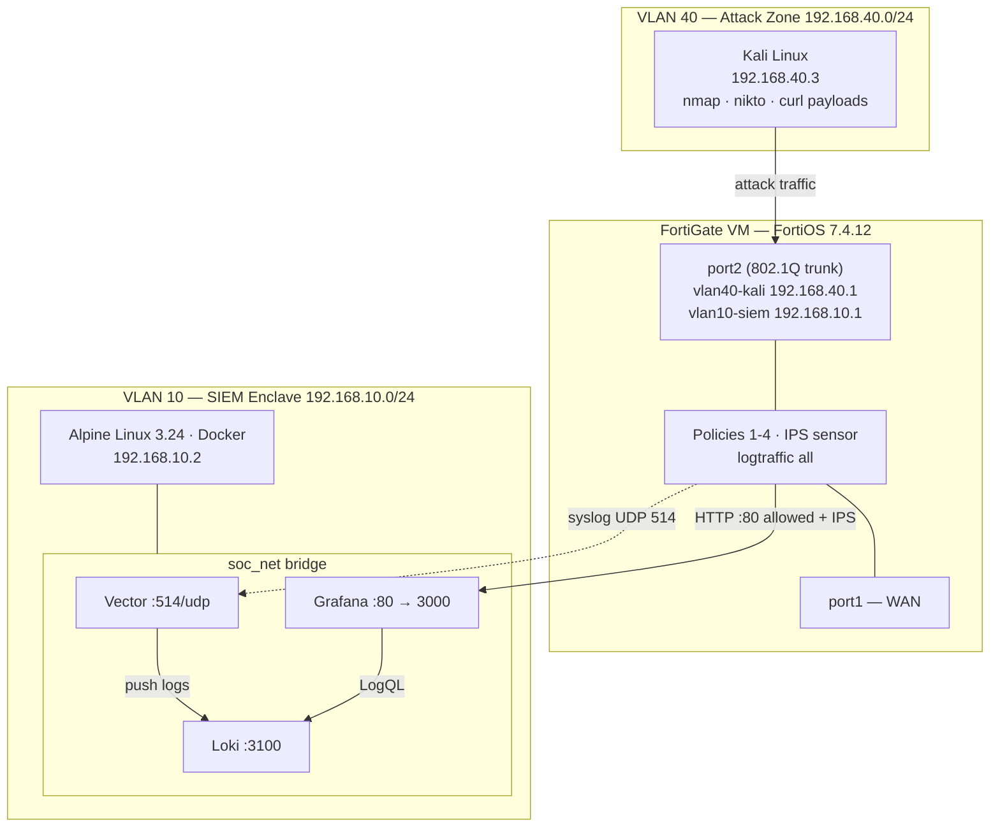

<!-- filepath: https://github.com/rabakuku/Youtube/blob/main/Video-3-Visual-SOC-Analytics-Traffic-Dashboard/docs/Lab-Matrix.md -->
# Lab-Matrix: Zero-Cost Visual SOC — "I Attacked My Own SOC"

A Kali Linux attacker in VLAN 40 launches a live attack campaign — a subnet sweep, a port scan, and web-attack payloads aimed at the SOC dashboard itself. The FortiGate sits between the VLANs, allows only HTTP to the dashboard (inspected by IPS), denies everything else, and logs every decision. Those logs stream over syslog to a free Vector → Loki → Grafana stack on Alpine Linux, where a pre-built "SOC Wallboard" lights up in real time: denied connections spike, the scanned ports appear as a ranked list, IPS signatures name the attacks, and the attacker's IP rises to the top. Demo outcome: the viewer watches an attack happen in one terminal and sees it detected, blocked, and visualized seconds later — with zero license cost for the SIEM.

## Project Variables

```text
PROJECT_NAME=visual-soc-analytics-traffic-dashboard     # also /opt/visual-soc-analytics-traffic-dashboard
GITHUB_URL=https://github.com/rabakuku/Youtube
GITHUB_BRANCH=main
PROJECT_DIR=Video-3-Visual-SOC-Analytics-Traffic-Dashboard
RAW_BASE=https://raw.githubusercontent.com/rabakuku/Youtube/main/Video-3-Visual-SOC-Analytics-Traffic-Dashboard
FORTIOS_VERSION=7.4.12
ALPINE_VERSION=3.24
FGT_VLAN10_IF=vlan10-siem   FGT_VLAN10_IP=192.168.10.1/24
FGT_VLAN40_IF=vlan40-kali   FGT_VLAN40_IP=192.168.40.1/24
FGT_PARENT_IF=port2
FGT_WAN_IF=port1
ALPINE_IP=192.168.10.2
CLIENT_IP=192.168.40.3   CLIENT_OS=Kali
APP_NAME=grafana   APP_IMAGE=grafana/grafana:10.3.3   APP_HOST_PORT=80   APP_CONTAINER_PORT=3000
VECTOR_IMAGE=timberio/vector:0.36.0-alpine   VECTOR_SYSLOG_PORT=514/udp
LOKI_IMAGE=grafana/loki:2.9.4                LOKI_PORT=3100 (internal to soc_net)
DOCKER_NETWORK=soc_net
SYSLOG_FACILITY=local7
FGT_ADDR_SOC_HOST=SOC-Host          # address object 192.168.10.2/32
FGT_IPS_SENSOR=SOC-Demo-IPS
FGT_POLICY_1=Kali_To_Internet       # accept, NAT, updates only
FGT_POLICY_2=Kali_To_SOC_Web        # accept HTTP to SOC-Host, IPS inspected
FGT_POLICY_3=Kali_To_Servers_Deny   # deny + log everything else VLAN40 to VLAN10
FGT_POLICY_4=SOC_To_Internet        # accept, NAT, apk + image pulls
GRAFANA_DASHBOARD_UID=fortinet-visual-soc
```

## Topology



## Addressing

| Node | Hostname | IP / Mask | Gateway | VLAN | Interface | Role |
|---|---|---|---|---|---|---|
| 1a | FortiGate-VM | 192.168.10.1/24 | — | 10 | port2 → vlan10-siem | SIEM-side gateway, syslog source |
| 1b | FortiGate-VM | 192.168.40.1/24 | — | 40 | port2 → vlan40-kali | Attacker-side gateway, inspection point |
| 1c | FortiGate-VM | DHCP / lab WAN | upstream | — | port1 | Internet egress (NAT) |
| 2 | soc-alpine | 192.168.10.2/24 | 192.168.10.1 | 10 | eth0 | Docker host: Vector, Loki, Grafana |
| 3 | kali | 192.168.40.3/24 | 192.168.40.1 | 40 | eth0 | Attacker + dashboard viewer |

## Stack

| Component | Version / Image | Runs on | Purpose |
|---|---|---|---|
| FortiGate VM | FortiOS 7.4.12 | EVE-NG | Routing, policy, IPS, syslog export |
| Alpine Linux | 3.24 | Node 2 | Lightweight Docker host (OpenRC) |
| Docker Engine + Compose | Alpine repo packages | Node 2 | Container runtime |
| Vector | timberio/vector:0.36.0-alpine | soc_net | Receives syslog, parses FortiOS key=value, ships to Loki |
| Loki | grafana/loki:2.9.4 | soc_net | Label-indexed log store (7-day retention) |
| Grafana | grafana/grafana:10.3.3 | soc_net, host :80 | Auto-provisioned Loki datasource + SOC Wallboard |
| Kali Linux | Rolling | Node 3 | nmap, nikto, curl — attack generator |

## Protocol / Port Schema

| # | Source → Destination | Protocol / Port | Direction | FortiGate policy | Purpose |
|---|---|---|---|---|---|
| 1 | Kali 192.168.40.3 → Grafana 192.168.10.2 | TCP 80 | VLAN40 → VLAN10 | 2 Kali_To_SOC_Web (accept, IPS) | View dashboard + web-attack payloads (inspected) |
| 2 | Kali 192.168.40.3 → 192.168.10.0/24 any other port | TCP/UDP/ICMP any | VLAN40 → VLAN10 | 3 Kali_To_Servers_Deny (deny, logged) | Subnet sweep + port scan → deny events |
| 3 | FortiGate 192.168.10.1 → Vector 192.168.10.2 | UDP 514 | FGT local-out → VLAN10 | none needed (local traffic) | Syslog stream of traffic + UTM logs |
| 4 | Vector → Loki | TCP 3100 | inside soc_net | n/a (Docker bridge) | Push parsed logs |
| 5 | Grafana → Loki | TCP 3100 | inside soc_net | n/a (Docker bridge) | LogQL queries |
| 6 | Alpine 192.168.10.2 → Internet | TCP 80/443, UDP 53 | VLAN10 → port1 | 4 SOC_To_Internet (accept, NAT) | apk packages, image pulls, raw GitHub downloads |
| 7 | Kali 192.168.40.3 → Internet | any | VLAN40 → port1 | 1 Kali_To_Internet (accept, NAT) | Tool updates only — never attack internet targets |

## Event Sequence (the on-camera demo)

1. Kali opens `http://192.168.10.2` — the SOC Wallboard is live and quiet (flow 1).
2. **Recon:** `nmap -sn 192.168.10.0/24` then `nmap -Pn --top-ports 200 192.168.10.2`. Everything except TCP 80 hits policy 3.
3. FortiGate writes `type="traffic" action="deny" policyid=3` logs for every probe and streams them to Vector over UDP 514.
4. Vector parses each key=value line into JSON, labels it `source=fortigate`, `action=<deny|accept|…>`, and pushes it to Loki.
5. Wallboard: **Denied Events** jumps, **Top Scanned Ports** fills with 22, 443, 3389…, **Top Attacker IPs** shows 192.168.40.3.
6. **Web attack:** `nikto -h http://192.168.10.2` plus a few curl payloads (SQLi, path traversal, Log4Shell-style header) on the one allowed port.
7. Policy 2's IPS sensor matches signatures and writes `type="utm" subtype="ips"` logs (action `dropped`/`reset`/`detected`).
8. Wallboard: **IPS Detections** and **Top IPS Signatures** populate with named attacks; the live event stream scrolls red.
9. Closing shot: side-by-side terminal + wallboard, attacker IP at the top of every panel.

## Security Trust Boundaries

- **VLAN 40 → VLAN 10:** only TCP 80 to the single host `SOC-Host` (192.168.10.2/32), and only through the IPS sensor. Everything else is explicitly denied *and logged* — the deny log is the demo's fuel. The FortiGate implicit deny does not log by default, which is why policy 3 exists.
- **VLAN 10 → VLAN 40:** no policy — the SIEM enclave never initiates connections to the attack zone.
- **Loki 3100:** not reachable from VLAN 40; it is only used inside `soc_net` (host binding limited to 127.0.0.1 for local debugging).
- **Syslog:** UDP 514 is unauthenticated plaintext — acceptable inside an isolated lab VLAN, called out on camera as a production caveat (use TCP/TLS syslog or FortiAnalyzer in production).
- **Internet egress:** both VLANs NAT out through port1 for updates; attack tools are aimed only at lab addresses.

## Assumptions

- FortiOS **7.4.12** (the repo badge says 7.4; the patch level is assumed). Interface names `vlan10-siem` / `vlan40-kali` are kept from the existing repo so your current FortiGate config still matches.
- IPS signature matching (steps 6–8) needs a FortiGate VM license with a current IPS package. Without one, the deny-based panels (steps 2–5) still work fully; the IPS panels will simply stay empty.
- **GeoIP is removed** from the scenario: every lab address is private (RFC 1918), so GeoIP lookups would return nothing. The old README's "geo-IP threat origins" claim is dropped to keep the video accurate.
- The "Windows PC 192.168.10.3" mentioned in docs/main.md and docs/Configuration.md is not part of this lab; Kali (192.168.40.3) is the only client.
- Loki retention is set to 7 days (168h), matching `LOKI_RETENTION_PERIOD` in `.env.example`.
- Branch `main`.
