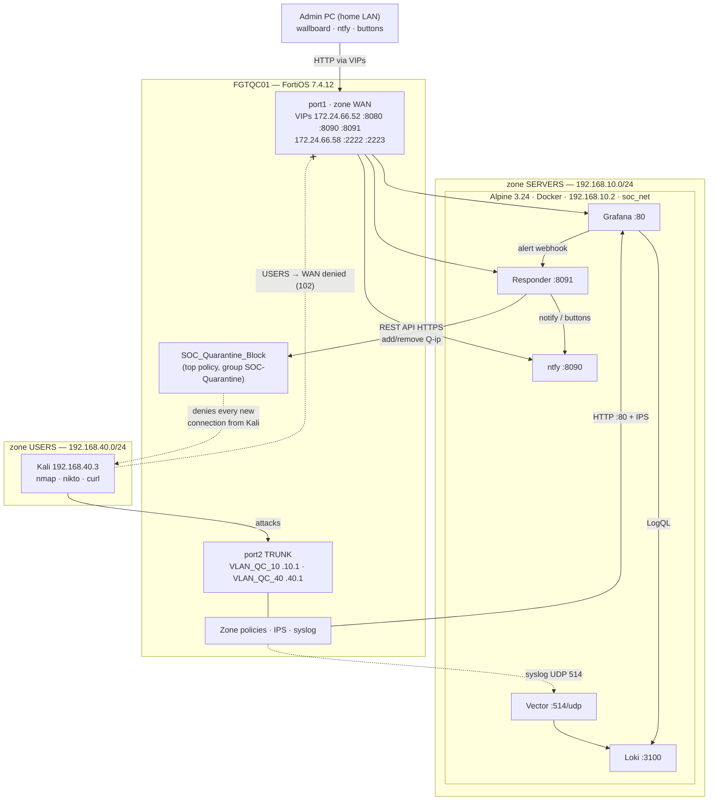

<!-- filepath: https://github.com/rabakuku/Youtube/blob/main/Video-3-Visual-SOC-Analytics-Traffic-Dashboard/docs/Lab-Matrix.md -->
# Lab-Matrix: Zero-Cost Visual SOC — "I Attacked My Own SOC" (Detect → Approve → Quarantine)

A Kali Linux attacker in the USERS zone — which has **no route to WAN** (work-lab rule) — launches a live attack campaign — a port scan, then web-attack payloads aimed at the SOC dashboard itself. The FortiGate (FGTQC01) allows only HTTP to the dashboard (inspected by IPS), denies and logs everything else, and streams every decision over syslog to a free Vector → Loki → Grafana stack on Alpine Linux. When a Grafana detection fires, a small **responder** service sends an **ntfy** notification to the admin PC with **[Quarantine 15 min] [Ignore]** buttons. One click and the responder puts the attacker into a FortiGate quarantine group: every new connection Kali tries — even plain HTTP to the dashboard — is denied, a "quarantined for 15 minutes" notification arrives, and a "released" notification follows when the timer ends or **[Release now]** is pressed. The wallboard stays live on the admin PC the whole time and shows the quarantine hits.

## Project Variables

```text
PROJECT_NAME=visual-soc-analytics-traffic-dashboard     # also /opt/visual-soc-analytics-traffic-dashboard
GITHUB_URL=https://github.com/rabakuku/Youtube
GITHUB_BRANCH=main
PROJECT_DIR=Video-3-Visual-SOC-Analytics-Traffic-Dashboard
RAW_BASE=https://raw.githubusercontent.com/rabakuku/Youtube/main/Video-3-Visual-SOC-Analytics-Traffic-Dashboard
UPLOAD_ARCHIVE=/home/beldex/Video-3-Visual-SOC-Analytics-Traffic-Dashboard.tar.gz   # scp target on the git box

# --- FortiGate (real lab) -------------------------------------------------
FGT_HOSTNAME=FGTQC01
FORTIOS_VERSION=7.4.12
FGT_PARENT_IF=port2            # alias TRUNK, 802.1Q
FGT_SERVERS_IF=VLAN_QC_10      # alias SERVERS, 192.168.10.1/24, zone SERVERS
FGT_USERS_IF=VLAN_QC_40        # alias USERS,   192.168.40.1/24, zone USERS
FGT_WAN_IF=port1               # zone WAN, local LAN → internet, 172.24.66.0/x
ZONE_SERVERS=SERVERS
ZONE_USERS=USERS
ZONE_WAN=WAN
ZONE_DMZ=DMZ                   # port3, unused in this lab
FGT_API_HOST=192.168.10.1      # HTTPS admin on VLAN_QC_10, reached by the responder

# --- Hosts --------------------------------------------------------------------
ALPINE_IP=192.168.10.2         # Docker host (SERVERS zone)
KALI_IP=192.168.40.3           # attacker (USERS zone)
ADMIN_PC=home LAN, reaches the lab through port1 VIPs

# --- Virtual IPs on port1 (existing + new) -----------------------------------
VIP_SSH_TO_SOC=172.24.66.58:2222 → 192.168.10.2:22      # existing
VIP_HTTP_TO_GRAFANA=172.24.66.52:8080 → 192.168.10.2:80 # existing
VIP_SSH_TO_KALI=172.24.66.58:2223 → 192.168.40.3:22     # existing
VIP_NTFY=172.24.66.52:8090 → 192.168.10.2:8090          # NEW  (name NTFY-TO-SOC)
VIP_RESPONDER=172.24.66.52:8091 → 192.168.10.2:8091     # NEW  (name RESPONDER-TO-SOC)
PUBLIC_GRAFANA_URL=http://172.24.66.52:8080
PUBLIC_NTFY_URL=http://172.24.66.52:8090
PUBLIC_RESPONDER_URL=http://172.24.66.52:8091

# --- Containers (Docker network soc_net) ------------------------------------
VECTOR_IMAGE=timberio/vector:0.36.0-alpine   # udp/514
LOKI_IMAGE=grafana/loki:2.9.4                # tcp/3100 (internal, 127.0.0.1 debug only)
GRAFANA_IMAGE=grafana/grafana:10.3.3         # host 80 → 3000
NTFY_IMAGE=binwiederhier/ntfy:v2.11.0        # host 8090 → 80
RESPONDER_IMAGE=python:3.12-alpine           # host 8091, built from app/responder (stdlib only)
DOCKER_NETWORK=soc_net

# --- FortiGate objects (referenced by NAME, IDs auto-assigned with edit 0) ----
FGT_ADDR_SOC_HOST=SOC-Host                   # 192.168.10.2/32
FGT_ADDR_KALI=Kali-Attacker                  # 192.168.40.3/32
FGT_QUARANTINE_GROUP=SOC-Quarantine          # address group; permanent member "none"
FGT_QUARANTINE_PREFIX=Q-                     # per-IP objects, e.g. Q-192.168.40.3
FGT_IPS_SENSOR=SOC-Demo-IPS
FGT_POLICY_QUARANTINE=100 SOC_Quarantine_Block   # any → any, deny + log, TOP of the list
FGT_POLICY_SOC_NET=2 SERVERS TO WAN               # existing, Alpine updates / image pulls
FGT_POLICY_KALI_WEB=3 Kali_To_SOC_Web             # was "USERS TO SERVERS": HTTP to SOC-Host, IPS
FGT_POLICY_KALI_DENY=101 Kali_To_Servers_Deny     # USERS → SERVERS, deny + log
FGT_POLICY_VIP=4 VIP TO INTERNAL                  # existing WAN → internal VIPs (+2 new VIPs)
FGT_POLICY_KALI_WAN=102 Kali_To_WAN_Deny          # USERS → WAN, deny + log — Kali never reaches WAN
FGT_API_USER=soc-responder                   # REST API admin, trusthost 192.168.10.2/32
FGT_API_PROFILE=soc-quarantine               # access profile: firewall address read-write only

# --- Quarantine behaviour (compose/.env) ---------------------------------------
QUARANTINE_MODE=approve                      # approve = buttons in ntfy, auto = ban at once
QUARANTINE_MINUTES=15
QUARANTINE_ALLOWLIST=192.168.10.0/24,192.168.10.1,172.24.66.0/24
NTFY_TOPIC=soc-alerts-<random>               # generated by setup.sh
GRAFANA_DASHBOARD_UID=fortinet-visual-soc
```

## Topology



## Addressing

| Node | Hostname | IP / Mask | Gateway | Zone / Interface | Role |
|---|---|---|---|---|---|
| 1a | FGTQC01 | 192.168.10.1/24 | — | SERVERS / VLAN_QC_10 on port2 | SIEM-side gateway, syslog source, REST API target |
| 1b | FGTQC01 | 192.168.40.1/24 | — | USERS / VLAN_QC_40 on port2 | Attacker-side gateway, inspection + quarantine point |
| 1c | FGTQC01 | 172.24.66.x (+ VIP IPs .52, .58) | upstream | WAN / port1 | Internet egress, admin access via VIPs |
| 2 | soc-alpine | 192.168.10.2/24 | 192.168.10.1 | SERVERS | Docker host: Vector, Loki, Grafana, ntfy, responder |
| 3 | kali | 192.168.40.3/24 | 192.168.40.1 | USERS | Attacker (driven over SSH-TO-KALI) |
| 4 | admin PC | home LAN | home router | outside the lab (WAN side) | Wallboard, ntfy web app, Approve/Release buttons |

## Stack

| Component | Version / Image | Runs on | Purpose |
|---|---|---|---|
| FortiGate VM | FortiOS 7.4.12 | EVE-NG | Zones, policies, IPS, syslog, VIPs, REST API, quarantine group |
| Alpine Linux | 3.24 | Node 2 | Docker host (OpenRC) |
| Vector | timberio/vector:0.36.0-alpine | soc_net | Syslog in, FortiOS parser, verdict tagging |
| Loki | grafana/loki:2.9.4 | soc_net | Log store, 7-day retention, single-node tuned |
| Grafana | grafana/grafana:10.3.3 | soc_net, host :80 | Wallboard, Detections dashboard, alert rules, webhook contact point |
| ntfy | binwiederhier/ntfy:v2.11.0 | soc_net, host :8090 | Push notifications with action buttons (web app + phone app) |
| Responder | python:3.12-alpine (stdlib only) | soc_net, host :8091 | Grafana webhook → ntfy buttons → FortiGate API; timers, allowlist, audit log to Loki |
| Kali Linux | Rolling | Node 3 | `kali-attack-campaign.sh` |

## Protocol / Port Schema

| # | Source → Destination | Protocol / Port | Direction / Zones | FortiGate policy | Purpose |
|---|---|---|---|---|---|
| 1 | Kali → Grafana 192.168.10.2 | TCP 80 | USERS → SERVERS | Kali_To_SOC_Web (accept, IPS) | Dashboard + web-attack payloads (inspected) |
| 2 | Kali → 192.168.10.0/24 other ports | any | USERS → SERVERS | Kali_To_Servers_Deny (deny, log) | Port scan → deny events |
| 3 | FGTQC01 192.168.10.1 → Vector | UDP 514 | local-out → SERVERS | none (local traffic) | Syslog: traffic + IPS logs |
| 4 | Vector → Loki · Grafana → Loki | TCP 3100 | inside soc_net | n/a | Push logs · LogQL |
| 5 | Grafana → Responder | TCP 8091 `/grafana` | inside soc_net | n/a | Alert webhook (firing + resolved) |
| 6 | Responder → ntfy | TCP 80 (container) | inside soc_net | n/a | Publish alerts, buttons, quarantine/release messages |
| 7 | Responder → FortiGate API 192.168.10.1 | TCP 443 HTTPS | SERVERS → local-in | none (admin access on VLAN_QC_10, trusthost 192.168.10.2) | Create/delete `Q-<ip>`, edit SOC-Quarantine members |
| 8 | Responder → Loki | TCP 3100 push API | inside soc_net | n/a | Audit events `source="responder"` for the wallboard |
| 9 | Admin PC → 172.24.66.52:8080 | TCP | WAN → SERVERS | VIP TO INTERNAL (existing) | Grafana wallboard |
| 10 | Admin PC → 172.24.66.52:8090 | TCP | WAN → SERVERS | VIP TO INTERNAL (+NTFY-TO-SOC) | ntfy web app (subscribe, see buttons) |
| 11 | Admin PC browser → 172.24.66.52:8091 | TCP | WAN → SERVERS | VIP TO INTERNAL (+RESPONDER-TO-SOC) | Button actions: quarantine / ignore / release (signed links) |
| 12 | Admin PC → 172.24.66.58:2223 | TCP | WAN → USERS | VIP TO INTERNAL (existing) | SSH to Kali — keeps working during quarantine (inbound session) |
| 13 | Quarantined Kali → anywhere | any | any → any | **SOC_Quarantine_Block** (deny, log) | Every new outbound connection blocked while quarantined |
| 14 | Alpine → internet | 80/443/53 | SERVERS → WAN | 2 SERVERS TO WAN (existing) | apk, image pulls, GitHub raw downloads |
| 15 | Kali → WAN (anything) | any | USERS → WAN | **102 Kali_To_WAN_Deny** (deny, log) | Kali never reaches WAN; attempts are visible and auditable |
| 16 | Admin PC → Kali via `scp -P 2223` | TCP | WAN → USERS | 4 VIP TO INTERNAL (SSH-TO-KALI) | How scripts get onto Kali (it has no internet) |

## Event Sequence (the on-camera demo)

1. Admin PC shows the wallboard (`http://172.24.66.52:8080`) and the ntfy web app (`http://172.24.66.52:8090/<topic>`) side by side; Kali terminal open over SSH-TO-KALI.
2. **Recon + scan:** `sudo ./kali-attack-campaign.sh --phase 2`. Kali_To_Servers_Deny logs ~1,000 denies → Vector → Loki; wallboard reads **UNDER ATTACK**.
3. Grafana rule **Port scan detected** fires for `srcip=192.168.40.3` → webhook to the responder (flow 5).
4. Responder checks the allowlist, then (QUARANTINE_MODE=approve) publishes to ntfy: *"Port scan from 192.168.40.3 — 412 ports in 60 s"* with **[Quarantine 15 min] [Ignore]** (flow 6).
5. Admin clicks **Quarantine 15 min** → the browser calls the signed link on 172.24.66.52:8091 (flow 11).
6. Responder calls the FortiGate API (flow 7): creates `Q-192.168.40.3`, adds it to `SOC-Quarantine`. Policy SOC_Quarantine_Block now denies every new connection from Kali.
7. ntfy: *"🚫 192.168.40.3 quarantined for 15 minutes"* with **[Release now]**; audit event to Loki (flow 8); wallboard shows the quarantine.
8. **Web attack:** `--phase 3` — every request times out, including the HTTP 80 that worked a minute ago; the SSH session to Kali stays up (flow 12). Wallboard: blocked events now carry `policyname=SOC_Quarantine_Block`.
9. After 15 minutes (or **Release now**) the responder removes the member and deletes `Q-192.168.40.3` → ntfy: *"✅ 192.168.40.3 released"*; Kali can reach the dashboard on HTTP 80 again (and still nothing else).
10. With QUARANTINE_MODE=auto, steps 4–5 are skipped: the ban happens at once and the same two notifications are sent.

## Security Trust Boundaries

- **USERS → SERVERS:** only TCP 80 to `SOC-Host`, IPS-inspected; everything else denied **and logged** (101).
- **USERS → WAN:** denied and logged (102). Kali has no internet; it only answers inside sessions the admin opens through `SSH-TO-KALI`.
- **Quarantine:** `SOC_Quarantine_Block` sits **above every other policy**, source `SOC-Quarantine`, any → any, deny + log. It blocks **new connections initiated by** the quarantined IP; inbound sessions that the admin starts through a VIP (SSH to Kali) keep working, so the demo stays under control. Traffic between hosts inside the same VLAN never reaches the FortiGate and is not blocked — full isolation needs switch/NAC quarantine (stated on camera).
- **Responder safety rails:** allowlist (never bans SERVERS, the FortiGate or the admin LAN), one active ban per IP, automatic expiry, Release button, every action audited to Loki. Button links are HMAC-signed with a per-install secret and expire after 30 minutes.
- **FortiGate API:** dedicated REST API admin `soc-responder` with access profile `soc-quarantine` (firewall address objects read-write, nothing else), token in `compose/.env` (mode 600, never committed), trusted host 192.168.10.2/32 only, HTTPS to 192.168.10.1.
- **Admin access:** only through port1 VIPs. `VIP TO INTERNAL` currently allows source `all` on the WAN side; restricting it to the admin PC's address is recommended (Stage 4 shows how).
- **Grafana/Loki/Vector/ntfy:** Loki and the Grafana → responder webhook never leave `soc_net`; ntfy uses a random topic name.
- **Syslog:** UDP 514 plaintext inside the lab — production caveat as before.

## Assumptions

- Interface names `VLAN_QC_10` / `VLAN_QC_40` and zone names `SERVERS` / `USERS` / `WAN` are taken from the FortiGate GUI screenshots (GUI shows *alias (name)*). Stage 4 starts with `show` commands to confirm them before anything is changed.
- Existing policies 2, 3 and 4 are the only ones on FGTQC01 (verified with `show firewall policy`). New policies use fixed IDs 100–102, so nothing existing can be overwritten; policy 3 is narrowed and renamed `Kali_To_SOC_Web`, policy 4 only gets two VIPs appended.
- No USERS → WAN accept exists or will be created: Kali must never reach WAN (work-lab rule). Scripts reach Kali by `scp` through `SSH-TO-KALI`; nmap, curl and nikto ship with the Kali image.
- port1 is DHCP (172.24.66.52/24) and that address carries the Grafana/ntfy/responder VIPs: it must be reserved on the upstream DHCP server.
- 192.168.10.2 and 192.168.40.3 currently come from the FortiGate DHCP ranges (.2–.250 / .3–.250). They must stay fixed because VIPs, the allowlist and the docs point at them: Stage 4 adds DHCP reservations (or set static IPs on the hosts).
- Quarantine uses an address group + deny policy rather than the FortiGate banned-IP list, so that the admin's inbound SSH to Kali survives the quarantine and the blocked attempts appear on the wallboard under their own policy name. The banned-IP list stays documented as an alternative.
- FortiOS does not allow an empty address group, so `SOC-Quarantine` always contains the built-in `none` (0.0.0.0/32) object.
- Notifications are viewed in the ntfy web app on the admin PC (desktop notifications via the browser); the ntfy phone app works while the phone is on the home LAN.
- One guide, `docs/config.md`, covers login, ntfy, the attack campaign, approval and investigation. Two dashboards remain: the Live Wallboard (home) and *Visual SOC · Detections & Response* (`app/app-advanced.json`).
- ntfy and responder image tags are pinned; the responder uses only the Python standard library (no pip installs at runtime).
- Branch `main`; uploads arrive on the git box at `/home/beldex/Video-3-Visual-SOC-Analytics-Traffic-Dashboard.tar.gz`.
