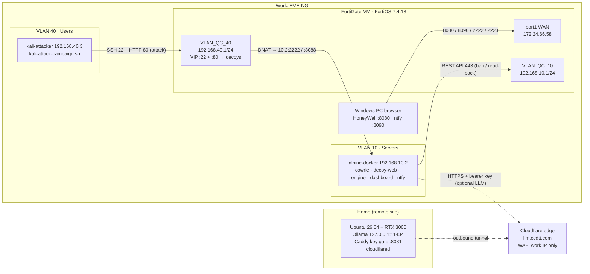

<!-- filepath: https://github.com/rabakuku/Youtube/blob/main/Video-4-HoneyWall-Live-Deception-SOC/docs/Lab-Matrix.md -->
# HoneyWall — Live Deception SOC with FortiGate Instant Auto-Quarantine

## 1. Scenario

The lab places two decoys in front of the Users VLAN, both running in Docker on Alpine Linux 3.24 and published by FortiOS 7.4.13 VIPs:
- **srv-corp-ssh01**, a Cowrie SSH honeypot on `192.168.40.1:22`
- **Corp Backup Console**, a web login decoy on `192.168.40.1:80`

The **HoneyWall engine** watches every connection, password, and keystroke the attacker sends. When an attacker crosses a line, the engine bans their IP on the FortiGate through the REST API, then reads the ban back from the FortiGate to prove it landed. Two kinds of line count:
- **noisy:** a brute-force threshold
- **stealthy:** touching a planted honeytoken

The **HoneyWall dashboard** turns all of this into a camera-ready live SOC:
- an animated topology
- a time-to-quarantine stopwatch
- a mirror of the attacker's terminal
- a credential wall and threat gauge
- the live banned list pulled from the FortiGate
- MITRE ATT&CK tags
- session replay

Alerts arrive in ntfy. An optional incident report is written by a local LLM (Ollama on a home RTX 3060), reached at `https://llm.ccdtt.com` through a Cloudflare Tunnel (Tailscale is the alternative). A single script on Kali plays the whole story in acts.

---

## 2. Project Variables

```text
PROJECT_NAME=honeywall                       # also /opt/honeywall on Alpine
GITHUB_URL=https://github.com/rabakuku/Youtube/tree/main/Video-4-HoneyWall-Live-Deception-SOC
REPO_FOLDER=Video-4-HoneyWall-Live-Deception-SOC
GITHUB_BRANCH=main
RAW_BASE=https://raw.githubusercontent.com/rabakuku/Youtube/main/Video-4-HoneyWall-Live-Deception-SOC
OLD_FOLDER=Video-4-Active-Honeypot-Instant-Auto-Quarantine   # retired, replaced by this folder

PUBLISH_HOST=bdx01  PUBLISH_USER=beldex  PUBLISH_CLONE=~/Youtube  PUBLISH_ARCHIVE_DIR=/home/beldex

FORTIOS_VERSION=7.4.13
ALPINE_VERSION=3.24
FGT_WAN_IF=port1            FGT_WAN_IP=172.24.66.58
FGT_PARENT_IF=port2
FGT_VLAN10_IF=VLAN_QC_10    FGT_VLAN10_IP=192.168.10.1/24   FGT_ZONE_SERVERS=SERVERS
FGT_VLAN40_IF=VLAN_QC_40    FGT_VLAN40_IP=192.168.40.1/24   FGT_ZONE_USERS=USERS
FGT_ZONE_WAN=WAN
FGT_API_USER=api_honeywall
FGT_API_PROFILE=PROF_HONEYWALL_API
FGT_API_TOKEN=<FGT_API_TOKEN>                # generated in Stage 5, stored only in .env

ALPINE_IP=192.168.10.2      ALPINE_HOSTNAME=alpine-docker
CLIENT_IP=192.168.40.3      CLIENT_OS=Kali   CLIENT_HOSTNAME=kali-attacker

DECOY_HOSTNAME=srv-corp-ssh01
DECOY_VIP_IP=192.168.40.1   DECOY_VIP_PORT=22
COWRIE_IMAGE=cowrie/cowrie:<pinned-tag>      # pinned in Stage 2
COWRIE_HOST_PORT=2222       COWRIE_CONTAINER_PORT=2222
FGT_VIP_DECOY=VIP_HONEYWALL_SSH22
WEB_DECOY_TITLE=Corp Backup Console   WEB_DECOY_HOSTNAME=backup.corp.local
WEB_DECOY_VIP_PORT=80       WEB_DECOY_HOST_PORT=8088
FGT_VIP_WEB=VIP_HONEYWALL_WEB80
WEB_HONEYTOKENS=/.env,/backup/.env.bak,/backup/db_dump.sql

DASHBOARD_NAME=HoneyWall    DASHBOARD_HOST_PORT=80
NTFY_HOST_PORT=8090         NTFY_TOPIC=honeywall
DOZZLE_HOST_PORT=9999
WAN_VIP_DASHBOARD=8080      WAN_VIP_NTFY=8090      WAN_VIP_DOZZLE=9999
WAN_VIP_ALPINE_SSH=2222     WAN_VIP_KALI_SSH=2223  # reserved, existing

COMPOSE_PROFILES_DEFAULT=standard
ENFORCEMENT_MODE=rest-ban                    # POST /api/v2/monitor/user/banned/add_users
BAN_EXPIRY=0                                 # 0 = permanent until Unban
BRUTE_THRESHOLD=5           BRUTE_WINDOW_SEC=30
DECOY_LEAKED_USER=svc_backup                 # Act 3 "leaked" credential (password set in Stage 2)
HONEYTOKENS=/root/.aws/credentials,/home/svc_backup/passwords.txt,/opt/backup/db_dump.sql

LLM_ENABLED=false                            # optional, toggle in .env / setup.sh / dashboard
LLM_ACCESS_MODE=cloudflare                   # cloudflare | tailscale | direct
LLM_HOST_OS=Ubuntu 26.04.x  LLM_GPU=RTX 3060 12GB
LLM_MODEL=llama3.1:8b
LLM_HOSTNAME=llm.ccdtt.com  CF_ZONE=ccdtt.com  CF_TUNNEL=honeywall-llm
LLM_GATE=Caddy 127.0.0.1:8081 (bearer key) -> Ollama 127.0.0.1:11434
LLM_BASE_URL=https://llm.ccdtt.com
LLM_API_KEY=<LLM_API_KEY>                    # printed by scripts/llm-host-setup.sh
```

---

## 3. Topology



---

## 4. Addressing Table

| Node | Hostname | Interface / VLAN | IP / Mask | Gateway | Role |
|---|---|---|---|---|---|
| 1 | FortiGate-VM | port1 (WAN zone) | 172.24.66.58 | upstream | Lab access VIPs, internet egress NAT |
| 1a | FortiGate-VM | VLAN_QC_10 on port2 (VLAN 10, zone SERVERS) | 192.168.10.1/24 | — | Servers gateway, REST API target |
| 1b | FortiGate-VM | VLAN_QC_40 on port2 (VLAN 40, zone USERS) | 192.168.40.1/24 | — | Users gateway, decoy VIPs `:22` and `:80`, enforcement point |
| 2 | alpine-docker | eth0 (VLAN 10) | 192.168.10.2/24 | 192.168.10.1 | Docker host: Cowrie, web decoy, engine, dashboard, ntfy |
| 3 | kali-attacker | eth0 (VLAN 40) | 192.168.40.3/24 | 192.168.40.1 | Attacker, runs kali-attack-campaign.sh |
| — | Windows PC | work LAN | (work DHCP) | — | Viewer: HoneyWall, ntfy, SSH to Alpine/Kali via WAN VIPs |
| — | GPU host | home LAN | (home), published as `llm.ccdtt.com` via Cloudflare Tunnel | home router | Optional LLM (Ollama) |

Docker internal network on Alpine: `172.28.10.0/24` (`honeywall_net`). It is never routed outside the host.

---

## 5. Stack

| Component | Version / Image | Runs on | Purpose |
|---|---|---|---|
| FortiGate-VM | FortiOS 7.4.13 | EVE-NG | Router/firewall, decoy VIP, REST ban enforcement |
| Alpine Linux | 3.24 | EVE-NG VM | Docker host |
| Docker Engine + Compose plugin | Alpine 3.24 packages | Alpine | Container runtime, profiles |
| Cowrie | `cowrie/cowrie:<pinned>` | Alpine container | SSH honeypot (decoy srv-corp-ssh01), JSON event log, TTY logs |
| HoneyWall web decoy | local build (`python:3.12-alpine` + aiohttp 3.14.5) | Alpine container | Fake "Corp Backup Console" login, robots.txt and `/backup/` bait, web honeytokens |
| HoneyWall engine | local build (`python:3.12-alpine` + aiohttp 3.14.5) | Alpine container | Detection rules (SSH + web), FortiGate REST ban/unban/read-back, stopwatch, alerts, reports, API + live stream |
| HoneyWall dashboard | local build (`nginx:alpine` + vanilla JS/SVG) | Alpine container | Camera-ready live SOC UI |
| ntfy | `binwiederhier/ntfy:<pinned>` | Alpine container | Alert feed (web page) |
| Dozzle | `amir20/dozzle:<pinned>` | Alpine container (full) | Live container logs |
| Tailscale | `tailscale/tailscale:<pinned>` | Alpine container (llm-tailscale) | Private path to home LLM |
| Kali Linux | rolling | EVE-NG VM | nmap, hydra, sshpass, campaign script |
| Ollama | latest stable | Home Ubuntu 26.04 + RTX 3060 | Optional LLM incident reports (`llama3.1:8b`) |
| Caddy | Ubuntu package / official repo | Home Ubuntu | Bearer-key gate in front of Ollama (Host rewrite to 127.0.0.1) |
| cloudflared | Cloudflare apt repo | Home Ubuntu | Outbound tunnel publishing `llm.ccdtt.com` (default access mode) |
| Tailscale | official installer | Home Ubuntu + lab sidecar | Alternative private access mode |

---

## 6. Protocol / Port Schema

| # | Source | Destination | Proto / Port | Direction | FortiGate policy | Purpose |
|---|---|---|---|---|---|---|
| F1 | Kali 192.168.40.3 | 192.168.40.1:22 → DNAT 192.168.10.2:2222 | TCP 22 → 2222 | USERS → SERVERS | `USERS_TO_DECOY_SSH` (dst VIP_HONEYWALL_SSH22, svc SSH) | Recon, brute force, decoy login |
| F1b | Kali 192.168.40.3 | 192.168.40.1:80 → DNAT 192.168.10.2:8088 | TCP 80 → 8088 | USERS → SERVERS | `USERS_TO_DECOY_WEB` (dst VIP_HONEYWALL_WEB80, svc HTTP) | Web recon, web brute force, web honeytokens |
| F2 | engine (Alpine 192.168.10.2) | FortiGate 192.168.10.1 | TCP 443 HTTPS | local-in on VLAN_QC_10 | `allowaccess https` + API trusthost 192.168.10.2/32 | REST ban, read-back, unban, status |
| F3 | Windows PC | 172.24.66.58:8080 → 192.168.10.2:80 | TCP | WAN → SERVERS | `WAN_TO_LAB_VIPS` | HoneyWall dashboard |
| F4 | Windows PC | 172.24.66.58:8090 → 192.168.10.2:8090 | TCP | WAN → SERVERS | `WAN_TO_LAB_VIPS` | ntfy web page |
| F5 | Windows PC | 172.24.66.58:9999 → 192.168.10.2:9999 | TCP | WAN → SERVERS | `WAN_TO_LAB_VIPS` | Dozzle (full profile) |
| F6 | Windows PC | 172.24.66.58:2222 → 192.168.10.2:22 | TCP | WAN → SERVERS | existing VIP (reserved) | SSH to Alpine (management) |
| F7 | Windows PC | 172.24.66.58:2223 → 192.168.40.3:22 | TCP | WAN → USERS | existing VIP (reserved) | SSH to Kali (management) |
| F8 | Alpine, Kali | Internet | TCP 80/443, UDP 41641 | SERVERS/USERS → WAN | `SERVERS TO WAN` (NAT) | Images, packages, Tailscale |
| F9 | engine | `https://llm.ccdtt.com` (Cloudflare edge → tunnel → Caddy :8081 → Ollama) | TCP 443 + bearer key | Alpine → internet | rides F8 | Optional LLM (**cloudflare mode, default**) |
| F9b | engine (via Tailscale sidecar proxy :1055) | GPU host `<tailnet-ip>:8081` | HTTP over WireGuard + bearer key | Alpine → home | rides F8 | Optional LLM (tailscale mode) |
| F10 | engine (internal) | Cowrie and web-decoy log volumes, ntfy, dashboard | Docker network | inside Alpine | n/a | Event tail, alert publish, live stream |

Kali is **not** allowed to reach HoneyWall, ntfy, Dozzle or the FortiGate API. The attacker only ever sees the decoy.

---

## 7. Event Sequence (core pipeline)

1. Kali opens TCP 22 (or 80) to `192.168.40.1`. The FortiGate VIP DNATs it to `192.168.10.2:2222` (Cowrie) or `192.168.10.2:8088` (web decoy), via policies `USERS_TO_DECOY_SSH` / `USERS_TO_DECOY_WEB`.
2. The decoys write JSON events:
   - Cowrie answers as `srv-corp-ssh01` and writes `cowrie.session.connect`, `cowrie.login.failed`, `cowrie.login.success`, `cowrie.command.input`, `cowrie.session.closed`.
   - The web decoy writes `web.request`, `web.login.failed`, `web.honeytoken`.
3. The engine tails both logs, normalizes each event, tags it with MITRE ATT&CK, updates the threat score, and pushes it live to the dashboard.
4. A rule fires. Either the brute-force threshold is hit (≥ 5 failed logins in 30 s, SSH and web combined), or a honeytoken is touched (in a shell command or as an HTTP download). The stopwatch starts at the timestamp of the triggering event (T0).
5. The engine calls `POST https://192.168.10.1/api/v2/monitor/user/banned/add_users` with `{"ip_addresses":["192.168.40.3"],"expiry":0}`.
6. The engine confirms with `GET /api/v2/monitor/user/banned`. When the IP is present, it records T1 and shows **Time-to-Quarantine = T1 − T0**.
7. The dashboard runs the quarantine sequence (red link, shield slam, optional siren and flash). ntfy receives an alert. If enabled, the LLM report is generated and attached.
8. From now on, packets from 192.168.40.3 are dropped by the FortiGate. The Kali session freezes or times out.
9. The operator clicks **Unban** on the dashboard. The engine calls `POST /api/v2/monitor/user/banned/clear_users`, confirms the IP is gone, and the dashboard returns to green.

---

## 8. Security Trust Boundaries

- **USERS → SERVERS:** only the two decoy VIPs (SSH 22, HTTP 80) are allowed. Kali cannot reach Alpine's real services, the dashboard, ntfy, or the Docker host directly.
- **SERVERS → FortiGate (local-in):** HTTPS from 192.168.10.2 only. The API admin's trusthost is 192.168.10.2/32, and its access profile is least-privilege (finalized in Stage 5).
- **WAN → lab:** only the listed VIP ports (2222, 2223, 8080, 8090, 9999). The dashboard has an optional basic-auth/token in `.env`.
- **VLAN_QC_40 allowaccess:** `ssh` and `http` are removed so the VIPs own ports 22 and 80. `ping` and `https` remain (HTTPS management from Users can also be removed; decided in Stage 5).
- **Secrets:** the FortiGate token, LLM key, and ntfy credentials live only in `/opt/honeywall/compose/.env`, never in the repo.
- **LLM path:** Ollama is bound to 127.0.0.1 on the home server, behind a Caddy gate that requires the bearer key. It is published only through the Cloudflare Tunnel `llm.ccdtt.com`, where a WAF custom rule (`honeywall-llm-allowlist`) blocks every source except the work public IP. Tailscale is the alternative (ACL: lab node → GPU node). No inbound ports are opened at home.

---

## 9. Demo Acts

| Act | Campaign script | What happens | Dashboard / alerts | Viewer feeling | Reset |
|---|---|---|---|---|---|
| **0 — Preflight** | `--preflight` | Checks tools, reachability of 192.168.40.1:22, and the engine health. It runs **before** any ban, because a banned Kali can't apt-install. | Topology all green, LIVE indicator on | "It's real, not a slide" | — |
| **1 — Recon** | `--act 1` | `nmap -sV -p 22,80 192.168.40.1` shows a normal OpenSSH server and an nginx "Backup Console"; `curl /robots.txt` reveals `/backup/` | Recon events, T1046 tag, HTTP lines in the terminal, packets animate Kali → FortiGate → decoys | "Looks like a juicy server" | none needed |
| **2 — Brute Force (noisy)** | `--act 2` | Hydra against `root`/`admin` with a small wordlist; the 5th failure inside 30 s trips the rule | Credential wall scrolls, threat gauge climbs, **QUARANTINE**: stopwatch freezes (target under 2 s), siren/flash, ntfy alert, banned list from FortiGate | "Whoa, that was instant" | **Unban** on camera from the PC |
| **3 — Let Them In… Slam the Door (stealthy)** | `--act 3` | A single clean login with the "leaked" `svc_backup` credential (no threshold); the attacker types recon commands, then `cat /root/.aws/credentials` | Live terminal mirrors each command (T1078, T1059.004); honeytoken hit (T1552.001) leads to **QUARANTINE** mid-command; the session freezes; the LLM report appears (if on) | "They let him in on purpose. Genius." | Unban after the proof |
| **3B — Web bait (bonus)** | `--act 3b` | The attacker browses the "Corp Backup Console", tries two web logins, then downloads `/backup/.env.bak` from the open directory listing | Web lines in the terminal, web chips on the credential wall, honeytoken over HTTP (T1190, T1552.001) leads to **QUARANTINE**; the next request times out | "Even the website was a trap" | Unban |
| **4 — Proof & Replay** | `--act 4` | A connect loop shows timeouts; FortiGate CLI/GUI shows the banned IP; the dashboard replays the attacker session | Replay player, report panel, Time-to-Quarantine scoreboard for both acts | "And here's the receipt" | Unban, end state green |

`--all` runs Acts 0 → 1 → 2 → 3 → 3B → 4 with narration pauses (`--no-pause` for a straight run). `--reset-check` waits until the engine reports 192.168.40.3 released. A web brute force (Hydra `http-post-form` against `/login`) also counts toward the same 5-in-30 s rule.

---

## 10. Showcase Features

| Priority | Feature | Delivered by |
|---|---|---|
| Must | Act storyline (noisy + stealthy triggers, reset on camera) | campaign script + engine rules |
| Must | Animated topology with real IPs, packet flow, block animation | dashboard |
| Must | Time-to-Quarantine stopwatch, T0 = event, T1 = FortiGate read-back | engine + dashboard |
| Must | Live attacker terminal mirror + credential wall + top-10 leaderboard | engine (Cowrie events) + dashboard |
| Must | Threat-score gauge tied to the rules | engine + dashboard |
| Must | Banned list live **from FortiGate** + Unban button | engine (REST) + dashboard |
| Must | MITRE ATT&CK tags on events | engine |
| Must | Alerts in ntfy (web page on PC) + HoneyWall pop-up toasts | engine + ntfy + dashboard |
| Must | Optional LLM incident report (toggle), home Ollama via `llm.ccdtt.com` | engine + `scripts/llm-host-setup.sh` |
| Must | Session replay | engine (Cowrie TTY logs) + dashboard |
| Must | Themes: Hollywood neon (default) / Enterprise SOC; sound + flash toggle; full/split layouts | dashboard |
| Must | Web login decoy ("Corp Backup Console") with web honeytokens, feeding the same engine | decoy-web (standard profile) |
| Nice | Telnet decoy | future option |
| Nice | Dozzle live logs | full profile |
| Nice | Grafana/Loki observability | future option |

---

## 11. Deployment Profiles

Profiles are set with `COMPOSE_PROFILES` in `.env`, or with `setup.sh --profile`. The LLM path is an add-on that can be combined with any profile.

| Profile | Services | Approx. RAM | Use |
|---|---|---|---|
| `lite` | cowrie, engine | ~300 MB | Minimal auto-quarantine, CLI-only demo |
| `standard` (**video default**) | lite + dashboard + ntfy + web decoy | ~550 MB | The full on-camera experience |
| `full` | standard + Dozzle | ~650 MB | Adds live container logs |
| LLM via Cloudflare (default) | no extra container (the engine calls `https://llm.ccdtt.com`) | 0 | `LLM_ENABLED=true` |
| add-on `llm-tailscale` | + tailscale sidecar | +60 MB | LLM over the tailnet: `COMPOSE_PROFILES=standard,llm-tailscale` |

---

## 12. Port Plan

**Alpine host ports**

| Host port | Service | Exposed via |
|---|---|---|
| 22 | Alpine sshd (real, management) | WAN VIP 2222 |
| 2222 | Cowrie (SSH decoy) | Users VIP 192.168.40.1:22 |
| 8088 | Web decoy (Corp Backup Console) | Users VIP 192.168.40.1:80 |
| 80 | HoneyWall dashboard (+ `/api` proxied to the engine) | WAN VIP 8080 |
| 8090 | ntfy | WAN VIP 8090 |
| 9999 | Dozzle (full) | WAN VIP 9999 |
| — | engine | internal only (Docker network) |

**FortiGate VIPs**

| VIP name | Ext IP:port | Mapped | Status |
|---|---|---|---|
| VIP_HONEYWALL_SSH22 | 192.168.40.1:22 | 192.168.10.2:2222 | new |
| VIP_HONEYWALL_WEB80 | 192.168.40.1:80 | 192.168.10.2:8088 | new |
| VIP_WAN_HONEYWALL_DASH | 172.24.66.58:8080 | 192.168.10.2:80 | new |
| VIP_WAN_HONEYWALL_NTFY | 172.24.66.58:8090 | 192.168.10.2:8090 | new |
| VIP_WAN_HONEYWALL_DOZZLE | 172.24.66.58:9999 | 192.168.10.2:9999 | new (full) |
| SSH-TO-Honeypot (existing) | 172.24.66.58:2222 | 192.168.10.2:22 | **reserved** |
| SSH-TO-KALI (existing) | 172.24.66.58:2223 | 192.168.40.3:22 | **reserved** |

Old VIPs from the previous version (`HTTP-TO-Mattermost`, the duplicate `:9001` entries, `VIP_COWRIE_HONEYPOT_2222`) are removed in Stage 5.

---

## 13. Self-Lockout Check

| Management path | Hit by the ban of 192.168.40.3? | Mitigation |
|---|---|---|
| PC → HoneyWall / ntfy (WAN → 10.2) | No | Unban is always reachable |
| PC → Alpine SSH (2222 → 10.2:22) | No | — |
| PC → Kali SSH (2223 → 40.3:22) | **Likely.** Reply traffic sourced from 40.3 may be dropped | Run the attack terminal from the **Kali VM console**. A side SSH session freezing is fine on camera ("even my own session got cut"). Confirmed in Stage 5. |
| Kali internet (apt, updates) | Yes, while banned | Act 0 preflight installs everything before Act 2 |
| FortiGate GUI/CLI from PC | No | — |

---

## 14. Assumptions

- Kali is statically 192.168.40.3, or reserved in the VLAN 40 DHCP server. No alias IPs.
- Existing zones (WAN/USERS/SERVERS/DMZ) and the `SERVERS TO WAN` NAT policy stay as they are. Alpine has internet for image pulls and Tailscale.
- Cowrie listens on container port 2222 and is published on host 2222; Alpine's real sshd keeps port 22.
- Honeytoken files are added to Cowrie's fake filesystem so `ls`/`cat` show them realistically (built in Stage 2). Detection works on the command text either way.
- **To verify in Stage 5:**
  - whether a REST ban also tears down an *existing* session; if not, the engine also closes the attacker's sessions through the API
  - whether the ban blocks reply traffic of WAN-initiated sessions to Kali
- `expiry: 0` means a permanent ban until cleared; this will be checked against 7.4.13 in Stage 5.
- LLM access defaults to **Cloudflare** with `llm.ccdtt.com`; `ccdtt.com` must use Cloudflare DNS. Tailscale and direct modes are also supported by `scripts/llm-host-setup.sh` (see `docs/LLM-Setup.md`).
- The FortiGate DNAT keeps the attacker's source IP, so both decoys see 192.168.40.3 (no SNAT on the decoy policies).
- ntfy is viewed as a web page on the PC (no desktop push). HoneyWall shows its own pop-up toasts.
- The dashboard is served over HTTP on port 80 inside the lab, with an optional access token.
